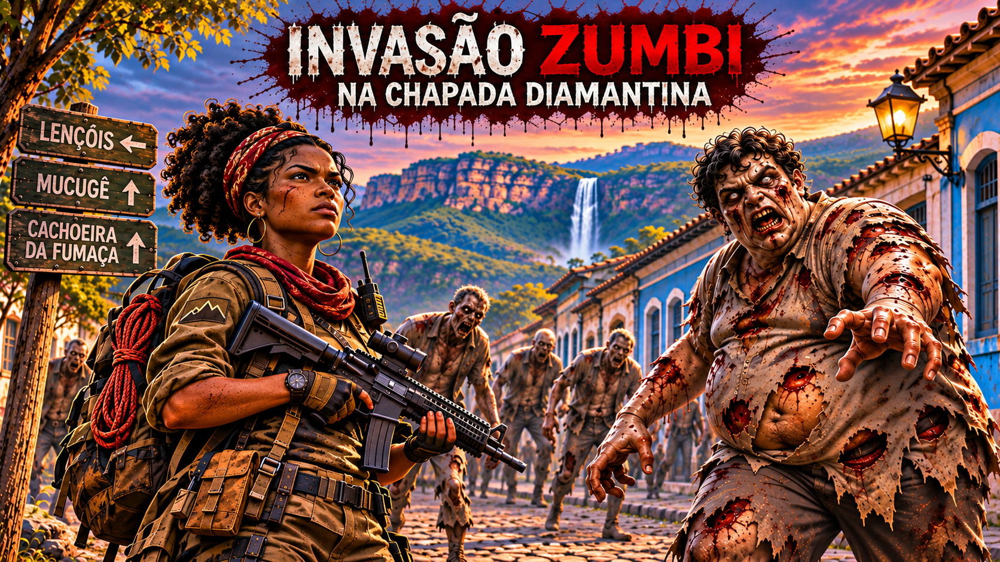

## 🎮 Sobre o jogo

*Invasão Zumbi na Chapada Diamantina* é um jogo 2D desenvolvido no **Unity**, no estilo *top-down*, ambientado na zona rural da Chapada Diamantina, Bahia.

Após uma misteriosa infecção transformar grande parte da população em zumbis, a **Capitã Silva**, uma ex-militar armada com um rifle, precisa atravessar áreas infestadas, enfrentar inimigos e alcançar um abrigo nas montanhas.

## ⚙️ Mecânicas principais

- Movimentação do personagem e ataques com rifle.
- Inimigos com diferentes níveis de dificuldade.
- Coleta de munição e kits médicos.
- Sistema de pontuação e condições de vitória e derrota.
- Temporizador regressivo.
- Tela inicial com seleção do personagem e instruções.
- Tela final com pontuação e resultado da partida.

**Objetivo:** atravessar o cenário da esquerda para a direita, sobreviver aos ataques e derrotar a horda final de zumbis para alcançar o refúgio.

## 🛠️ Tecnologias

- **Engine:** Unity 2022.3.27f1 ou 6000.3.0f1
- **Linguagem:** C#
- **Estilo:** 2D Top-Down
- **Recursos:** Sprites, Prefabs, Física 2D, Animações e Partículas

## 📊 Critérios de avaliação

| Critério | Peso |
|---|---:|
| Programação e física dos elementos | 70% |
| Organização visual da cena | 10% |
| Game Design e jogabilidade | 20% |
| **Total** | **100%** |

A ausência ou implementação parcial de cada requisito essencial poderá resultar em desconto de **1 ponto** na nota final.

## 📦 Entrega

A atividade poderá ser desenvolvida **individualmente ou em dupla**.

**Prazo do Upload via Classroom:** 30/11/2026, até as 12h.

Enviar pelo Google Classroom um arquivo de texto contendo:

1. Link do jogo no Unity Play.
2. Link do repositório GitHub com o código-fonte.
3. Link do vídeo de gameplay no YouTube.

## 📚 Referência

[Zombie Rural — Vídeo de referência](https://www.youtube.com/watch?v=vqDu9_FdA0A&t=29s)

---

**Boa sorte e bom desenvolvimento!**
